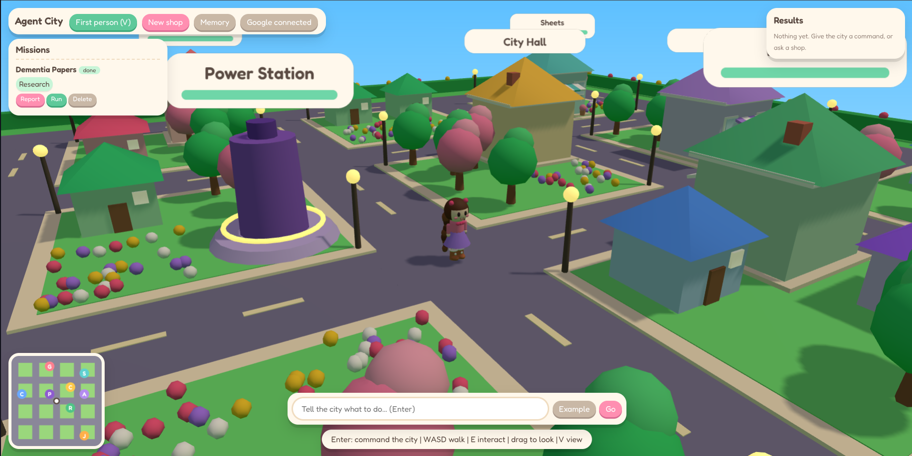

# Agent City

A 3D city of AI agents that does your work for you. Type **one command** and the Mayor in City Hall plans it, hands steps to the right shops (Jobs, Research, Gmail, Calendar, Sheets, or any shop you build), runs independent steps in parallel, reviews the results and gives you a final report. Couriers run between shops so you can watch it happen.

Example: *"Find internships for a CS student who knows Python, save them to a Google Sheet and email me the top 5."*



## What it does
- **Missions:** the Mayor splits a goal into dependent steps, runs them, checks the work and adds follow-ups if something is missing.
- **Scheduled runs:** "every day at 9" saves the mission and re-runs it automatically, reporting only new results.
- **Shops:** talk to any shop directly, e.g. read your calendar, search your inbox, view saved sheets, search jobs or research papers.
- **Job search:** LinkedIn public listings, Rozee.pk and remote boards (Remotive, Jobicy, Himalayas, RemoteOK, WeWorkRemotely, Jooble).
- **Memory & archive:** facts about you are shared with every shop, and past results are searchable (BM25 retrieval).
- **Custom agents:** create a shop from a purpose plus a set of tools; the Mayor uses it right away.
- **Safety:** emails wait for your approval, and web/email content is treated as untrusted.

## Tech used
- **Backend:** Node.js (20.12+), Express
- **Frontend:** Three.js (3D city), plain HTML/CSS/JavaScript
- **AI:** free LLM providers with automatic fallback: Groq, Google Gemini, OpenRouter, or local Ollama
- **Integrations:** Google OAuth with Gmail, Calendar and Sheets APIs; Tavily / Brave / DuckDuckGo web search
- **Storage:** local JSON files in `data/`

## Run it
```bash
cp .env.example .env     # add at least one free AI key (e.g. GROQ_API_KEY)
npm install
npm start                # http://localhost:3001
```
For Gmail, Calendar and Sheets, create an OAuth client in Google Cloud Console (enable the three APIs, redirect URI `http://localhost:3001/oauth2callback`), put the ID and secret in `.env`, then click **Connect Google** in the app.
